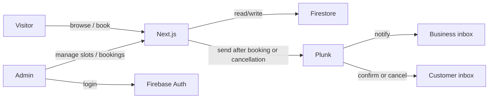

# Southeastern Electrical — Marketing Site + Call Booking

Living implementation plan. Check boxes as work lands. Update this file as we build.

**Last updated:** 2026-10-02

## Progress

- [x] Scaffold Next.js (user: `create-next-app` — TypeScript, Tailwind, ESLint, App Router)
- [x] Add Prettier (`eslint-config-prettier`, `prettier-plugin-tailwindcss`); `format` / `format:check` scripts
- [x] Wire Firebase client (Auth) + Admin SDK + env template
- [x] Define Firestore model + Admin helpers + transaction-safe booking write
- [x] Brand-first marketing pages (home, services/about, CTA to book)
- [x] Public booking UI: day picker, slots, name + phone, confirmation
- [x] Plunk business and optional customer email on successful booking
- [x] Firebase Auth admin login + protected `/admin` routes
- [x] Admin: view/cancel bookings, weekly hours, blackouts, notify settings
- [x] Cancellation emails and calendar cancellation using stored invite identities
- [x] Availability conflict previews and explicit cancellation resolutions
- [x] Overlap-safe transactions across slot length, hours, and timezone changes
- [x] Adjustable notice period, booking window, and week navigation
- [x] Client-controlled notification recipients and guarded maintenance scripts
- [x] Unit and Firestore emulator regression tests

---

## Stack (confirmed)

| Layer         | Choice                            | Role                                        |
| ------------- | --------------------------------- | ------------------------------------------- |
| App           | Next.js (App Router) + TypeScript | Marketing pages + API routes                |
| Styling       | Tailwind CSS                      | Utility styling for marketing + admin       |
| Lint / format | ESLint + Prettier                 | Lint on save/CI; consistent formatting      |
| DB            | Firestore                         | Bookings, availability overrides, settings  |
| Auth          | Firebase Auth                     | **Admin only** (customers are guests)       |
| Email         | Plunk                             | Business notifications and customer notices |
| Hosting       | Vercel (typical for Next.js)      | Deploy                                      |

No customer accounts. Booking form: **name + phone + optional email** (+ selected date/time). Business recipients receive booking notifications; customers can receive confirmation invites and cancellation notices.

## Architecture

**Booking flow:** visitor picks date → available slots load from Firestore → submits name + phone + optional email → Server Action / API route transactionally checks overlapping appointments and creates the booking, then sends business and optional customer emails.

**Admin flow:** staff logs in → views upcoming bookings → sets weekly hours, blocks days/slots, optionally cancels.

## Data model (Firestore)

- `settings/booking` — timezone, slot length, weekly hours, notify emails, minimum notice, and booking window
- `availabilityOverrides/{date}` — closed days, extra open hours, blocked slot times
- `bookings/{id}` — name, phone, optional email/customer timezone, original invite UID/organizer, startsAt/endsAt, status, creation/cancellation times, and cancellation-notice result
- `bookingDays/{UTC-date}` — shared transaction locks. Booking ranges are the source of truth; legacy `slots` documents are ignored.

**Security:**

- Public booking writes only via Next.js server (Admin SDK) — no client Firestore writes
- Admin UI uses Auth; privileged ops via authenticated API routes / Admin SDK after session verify

## App surfaces

### Marketing (public)

- Home: brand-first hero, services overview, trust/CTA to book a call
- Services / About
- Contact + primary CTA → **Book a callback**
- Booking page: live calendar → time slots → name + phone + optional email → confirmation

**Design:** industrial-clean trades look (deep navy/charcoal, amber or electric yellow accent, strong wordmark). Expressive fonts; full-bleed hero. Motion: subtle hero reveal + slot selection feedback.

### Admin (protected)

- Login (`/admin/login`)
- Dashboard (`/admin`): upcoming/past bookings; cancel
- Availability (`/admin/availability`): weekly hours, blackouts, block slots
- Settings: notify emails, slot duration, timezone, minimum notice, and booking window

## Plunk

On successful booking (server-side):

- To: configured business address(es)
- Subject: `New callback booking — {name} — {formatted time}`
- Body: name, phone, datetime, timezone

Env: `PLUNK_API_KEY`, verified `PLUNK_FROM_EMAIL`, and `SITE_URL`. `BOOKING_NOTIFY_EMAIL` is bootstrap-only. Optional `BUSINESS_PHONE` is included in cancellation emails. See README for rollout and backfill steps.

## Implementation notes

1. Prettier after scaffold; Firebase client + Admin + Plunk env next
2. Slot generation: weekly hours + overrides − non-cancelled bookings
3. Double-book guard: Firestore transaction
4. Admin session: Auth cookie / verify on `/admin/*` and admin APIs
5. Optional customer email for confirmation invites and cancellation notices

## Env to provision

- [ ] Firebase project + service account
- [ ] Firebase web config (client Auth)
- [ ] Plunk API key, verified sender, SITE_URL, and client-owned Settings recipients
- [ ] Admin user in Firebase Auth

## Out of scope (v1)

- SMS notifications (customer confirmation and cancellation emails are implemented)
- Google Calendar sync
- Online payments
- Multi-staff calendars

## Suggested layout

- `app/` — marketing, `book/`, `admin/`
- `app/api/` or Server Actions — `book`, `slots`, admin CRUD
- `lib/firebase/` — client + admin init
- `lib/booking/` — slot math, validation
- `lib/plunk.ts` — send notification
- Config: `eslint.config.mjs`, `.prettierrc`, `.prettierignore`, Tailwind / PostCSS
