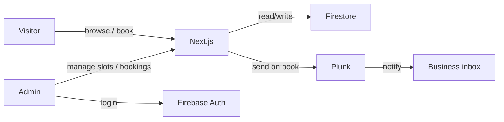

# South Eastern Electrical — Marketing Site + Call Booking

Living implementation plan. Check boxes as work lands. Update this file as we build.

**Last updated:** 2026-07-15

## Progress

- [x] Scaffold Next.js (user: `create-next-app` — TypeScript, Tailwind, ESLint, App Router)
- [x] Add Prettier (`eslint-config-prettier`, `prettier-plugin-tailwindcss`); `format` / `format:check` scripts
- [ ] Wire Firebase client (Auth) + Admin SDK + env template
- [ ] Define Firestore model + Admin helpers + transaction-safe booking write
- [ ] Brand-first marketing pages (home, services/about, CTA to book)
- [ ] Public booking UI: day picker, slots, name + phone, confirmation
- [ ] Plunk business-only email on successful booking
- [ ] Firebase Auth admin login + protected `/admin` routes
- [ ] Admin: view/cancel bookings, weekly hours, blackouts, notify settings

---

## Stack (confirmed)

| Layer         | Choice                            | Role                                       |
| ------------- | --------------------------------- | ------------------------------------------ |
| App           | Next.js (App Router) + TypeScript | Marketing pages + API routes               |
| Styling       | Tailwind CSS                      | Utility styling for marketing + admin      |
| Lint / format | ESLint + Prettier                 | Lint on save/CI; consistent formatting     |
| DB            | Firestore                         | Bookings, availability overrides, settings |
| Auth          | Firebase Auth                     | **Admin only** (customers are guests)      |
| Email         | Plunk                             | Notify business when a slot is booked      |
| Hosting       | Vercel (typical for Next.js)      | Deploy                                     |

No customer accounts. Booking form: **name + phone** (+ selected date/time). Emails go **only to the business**.

## Architecture

**Booking flow:** visitor picks date → available slots load from Firestore → submits name + phone → Server Action / API route atomically creates booking, marks slot taken, sends Plunk email to business.

**Admin flow:** staff logs in → views upcoming bookings → sets weekly hours, blocks days/slots, optionally cancels.

## Data model (Firestore)

- `settings/booking` — timezone, slot length (e.g. 30 min), default weekly hours, business notify email(s)
- `availabilityOverrides/{date}` — closed days, extra open hours, blocked slot times
- `bookings/{id}` — `name`, `phone`, `startsAt`, `endsAt`, `status` (`confirmed` | `cancelled`), `createdAt`
- Transaction or `slots/{slotId}` with `booked: true` to prevent double-booking

**Security:**

- Public booking writes only via Next.js server (Admin SDK) — no client Firestore writes
- Admin UI uses Auth; privileged ops via authenticated API routes / Admin SDK after session verify

## App surfaces

### Marketing (public)

- Home: brand-first hero, services overview, trust/CTA to book a call
- Services / About
- Contact + primary CTA → **Book a callback**
- Booking page: calendar → time slots → name + phone → confirmation

**Design:** industrial-clean trades look (deep navy/charcoal, amber or electric yellow accent, strong wordmark). Expressive fonts; full-bleed hero. Motion: subtle hero reveal + slot selection feedback.

### Admin (protected)

- Login (`/admin/login`)
- Dashboard (`/admin`): upcoming/past bookings; cancel
- Availability (`/admin/availability`): weekly hours, blackouts, block slots
- Settings: notify email, slot duration, timezone (default America/New_York)

## Plunk

On successful booking (server-side):

- To: configured business address(es)
- Subject: `New callback booking — {name} — {formatted time}`
- Body: name, phone, datetime, timezone

Env: `PLUNK_API_KEY`, `BOOKING_NOTIFY_EMAIL`

## Implementation notes

1. Prettier after scaffold; Firebase client + Admin + Plunk env next
2. Slot generation: weekly hours + overrides − non-cancelled bookings
3. Double-book guard: Firestore transaction
4. Admin session: Auth cookie / verify on `/admin/*` and admin APIs
5. No customer email field in v1

## Env to provision

- [ ] Firebase project + service account
- [ ] Firebase web config (client Auth)
- [ ] Plunk API key + notify address
- [ ] Admin user in Firebase Auth

## Out of scope (v1)

- Customer confirmation emails / SMS
- Google Calendar sync
- Online payments
- Multi-staff calendars

## Suggested layout

- `app/` — marketing, `book/`, `admin/`
- `app/api/` or Server Actions — `book`, `slots`, admin CRUD
- `lib/firebase/` — client + admin init
- `lib/booking/` — slot math, validation
- `lib/plunk.ts` — send notification
- Config: `eslint.config.mjs`, `.prettierrc`, `.prettierignore`, Tailwind / PostCSS
